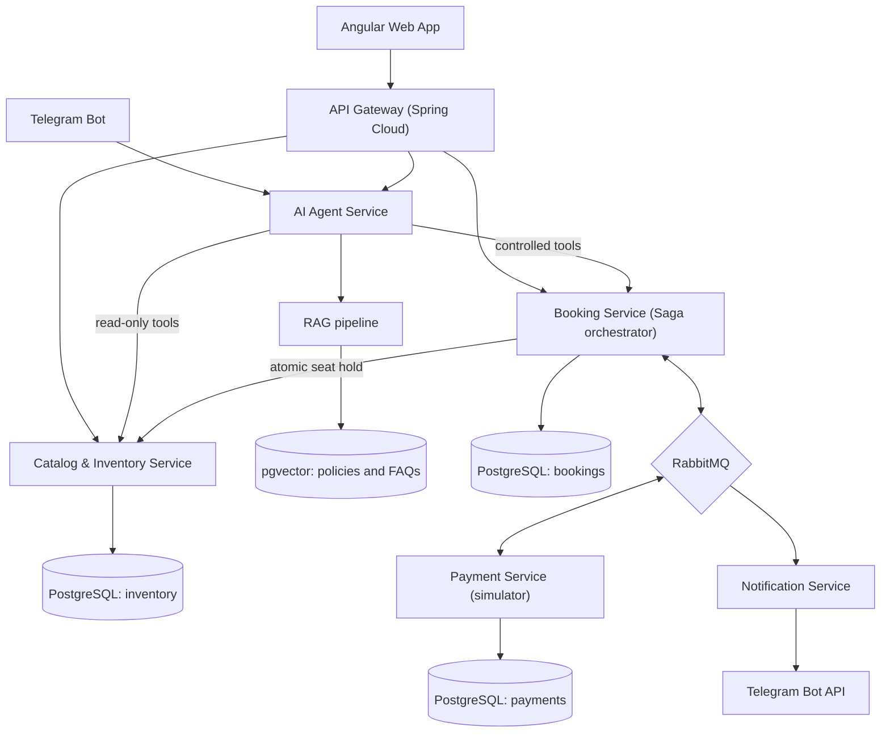
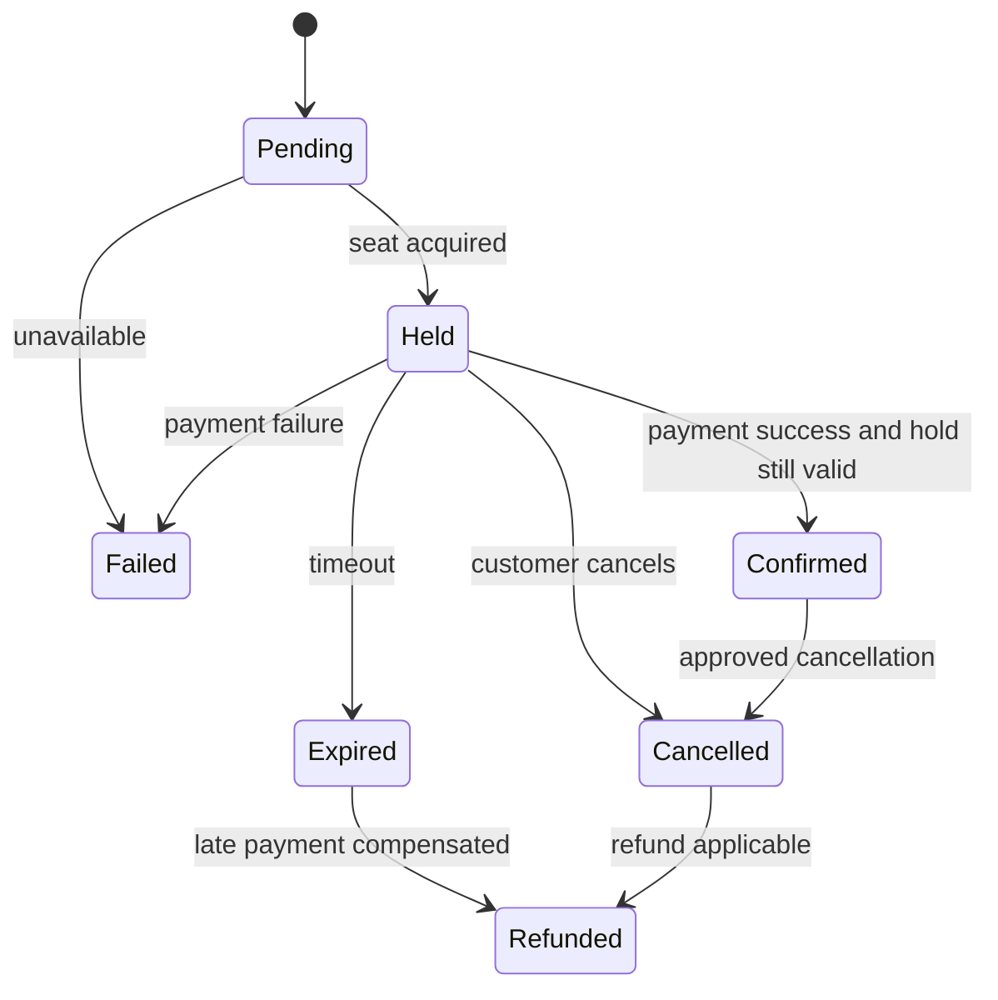
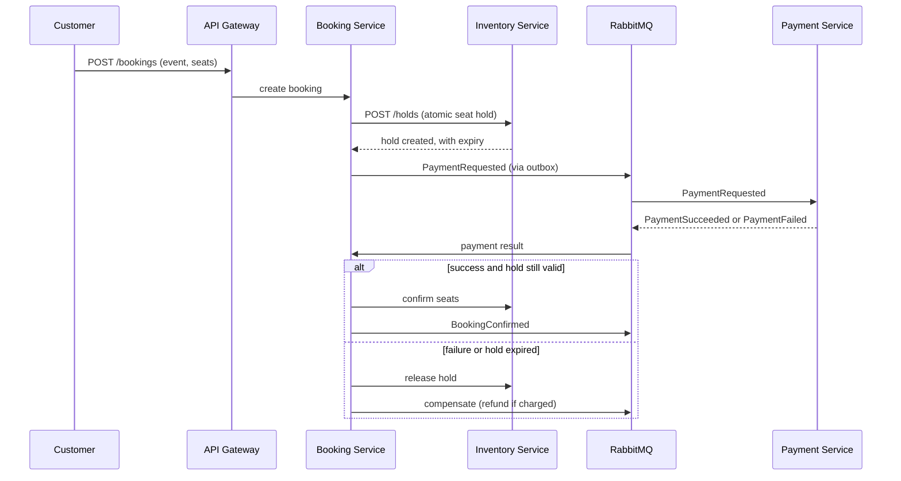

# Architecture

## Container view (C4)

Each business service owns its database. There are no cross-service foreign keys.

## Reservation state machine

## Booking sequence (happy path and compensation)

