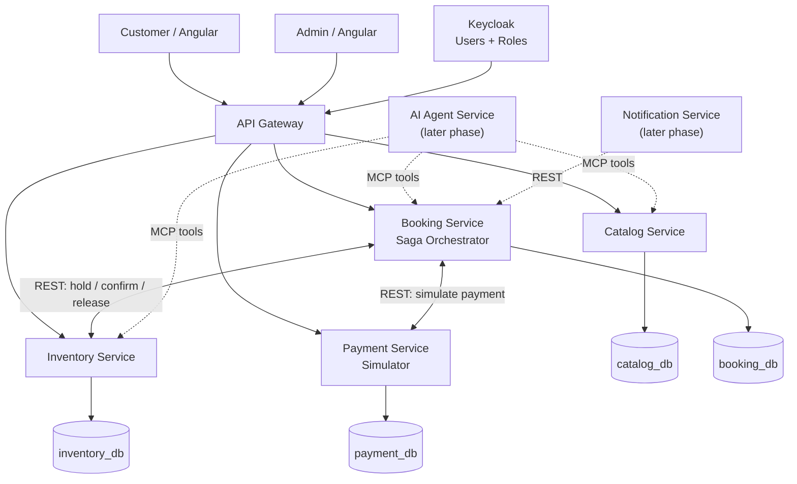
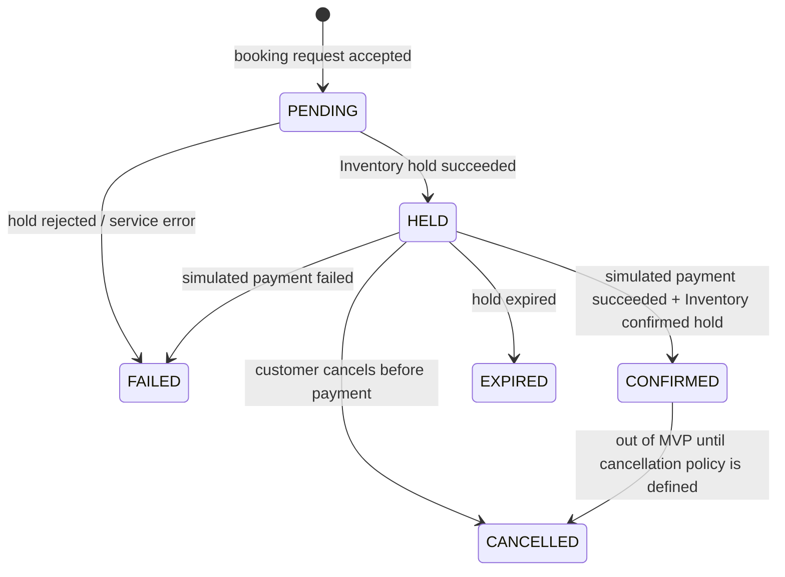

# Architecture — EventFlow AI MVP

## 1. Architectural decisions

- Independently deployable business services with one PostgreSQL database per service.
- Synchronous REST for service-to-service calls in the MVP.
- Booking Service orchestrates the reservation Saga.
- Payment Service simulates a payment result; it does not connect to a bank or payment provider.
- Keycloak is the identity provider. Roles are `CUSTOMER` and `ADMIN`.
- RabbitMQ/Kafka and asynchronous messaging are not part of this MVP.
- Notification and AI/RAG implementations are deferred. MCP interfaces are planned for Catalog, Inventory, and Booking; GraphQL is a future extension.

## 2. Container view (C4)



The AI and notification components are shown as future extensions; they are not started by the current Docker Compose file. Each business service owns its database. There are no cross-service foreign keys or JPA relationships.

## 3. Service ownership

| Service | Owns | Does not own |
|---|---|---|
| Catalog | Events and event lifecycle | Seats, bookings, users |
| Inventory | Seats, holds, availability and hold expiry | Events, bookings, payments |
| Booking | Customer booking records, booking items, Saga orchestration | User credentials, seats, payment ledger |
| Payment | One simulated payment result per booking | Real payment processing, refunds |
| Keycloak | Identity, credentials and roles | Business booking data |
| AI Agent (later) | RAG documents/chunks and agent orchestration | Business source-of-truth data |
| Notification (later) | Delivery preferences/history if needed | Booking/payment state |

## 4. Reservation state machine



`REFUNDED` is intentionally absent: the MVP does not move real money and does not implement refunds. Cancellation of a confirmed booking is outside the current scope.

## 5. Booking sequence (REST-only happy path)

```mermaid
sequenceDiagram
    participant C as Customer
    participant G as API Gateway
    participant B as Booking Service
    participant I as Inventory Service
    participant P as Payment Simulator

    C->>G: POST /api/bookings (eventId, seatIds)
    G->>B: create booking under authenticated customer
    B->>B: persist Booking(PENDING)
    B->>I: POST /internal/holds (bookingId, seatIds)
    I->>I: atomically hold all requested seats
    I-->>B: hold result, seat prices, expiresAt
    B->>B: persist BookingItems, total, holdExpiresAt; status HELD
    B-->>C: booking HELD + expiry
    C->>G: POST /api/bookings/{id}/confirm-payment
    G->>B: explicit customer confirmation
    B->>P: POST /internal/payments/simulate
    P-->>B: SUCCEEDED or FAILED
    alt simulation succeeded
        B->>I: POST /internal/holds/{bookingId}/confirm
        I-->>B: confirmed or expired/rejected
        alt Inventory confirms hold
            B->>B: status CONFIRMED
            B-->>C: booking confirmed
        else hold no longer valid
            B->>B: status EXPIRED or FAILED
            B->>I: release any still-active hold
            B-->>C: booking not confirmed (no real charge exists)
        end
    else simulation failed
        B->>I: DELETE /internal/holds/{bookingId}
        B->>B: status FAILED
        B-->>C: payment simulation failed
    end
```

The Payment response is synchronous. A successful simulation is not a real charge. If Inventory refuses confirmation because the hold expired, no refund is required because no money was collected.

## 6. Hold ownership and expiry

- `SeatHold.expiresAt` in Inventory is the authoritative expiry timestamp.
- `Booking.holdExpiresAt` is an optional snapshot returned by Inventory so Booking/UI can display the deadline.
- Inventory alone expires holds and changes the corresponding Seat back to `AVAILABLE`.
- Default hold duration is 10 minutes.
- A booking cannot be confirmed unless the Inventory hold is still active and successfully confirmed.

## 7. REST and MCP boundaries

- REST is used by Angular/API Gateway and for synchronous internal service calls.
- Catalog MCP tools are read-only event search/detail tools.
- Inventory MCP tools are read-only availability/seat detail tools.
- Booking MCP tools may create a booking hold and read the authenticated customer's bookings/status. They cannot simulate payment or confirm payment.
- Payment exposes REST only. The customer confirms payment through Booking REST; Booking calls Payment internally.
- MCP tools are implemented as MCP tool components/handlers, not as ordinary `@RestController` methods.
- GraphQL is not implemented in the MVP.

## 8. Consistency and failure handling

- Inventory uses database transactions, conditional updates/locking, and a partial unique index to enforce one active hold per seat.
- Booking orchestrates the steps and performs compensating REST calls (release hold) when payment simulation fails.
- Calls between services must have bounded timeouts and return explicit errors.
- Payment uses a unique `booking_id` so repeated simulation requests for the same booking return the existing result rather than creating a second payment record.
- There is no distributed transaction. The Saga is a sequence of local transactions and REST calls.


## 6. Source diagrams and class design

- [System context](../uml/01-system-context.mmd)
- [Service architecture](../uml/02-service-architecture.mmd)
- [Domain class diagram](../uml/03-domain-class-diagram.mmd)
- [Database ERD](../uml/04-database-erd.mmd)
- [Booking sequence](../uml/05-booking-sequence.mmd)
- [Booking state machine](../uml/06-booking-state-machine.mmd)
- [Java class design](../classes/CLASS_DESIGN.md)
