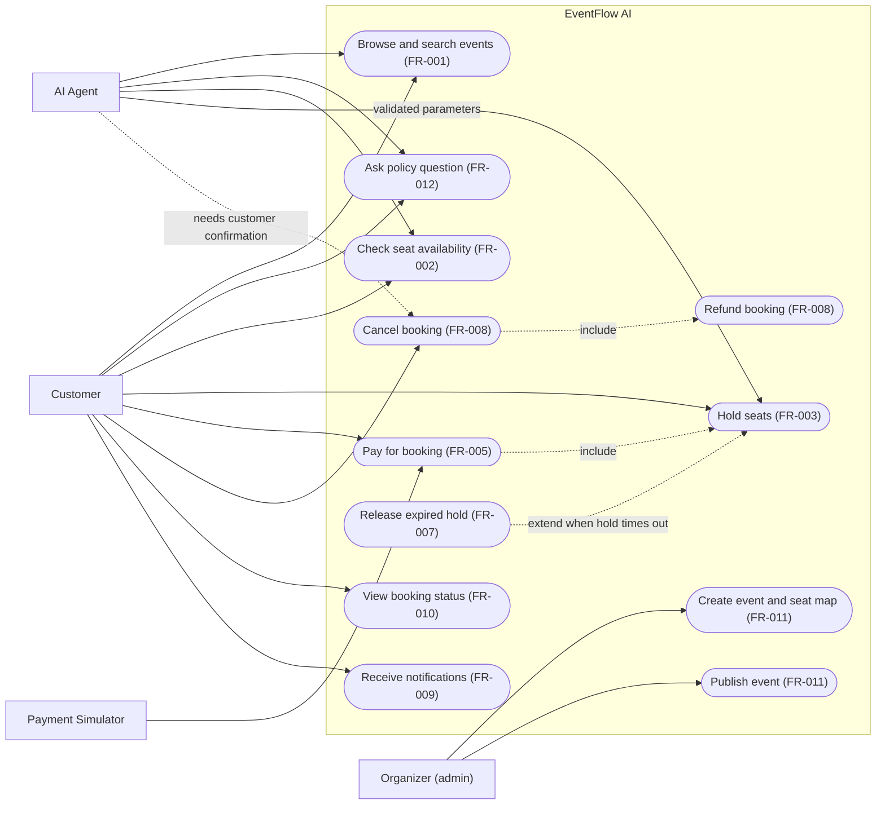
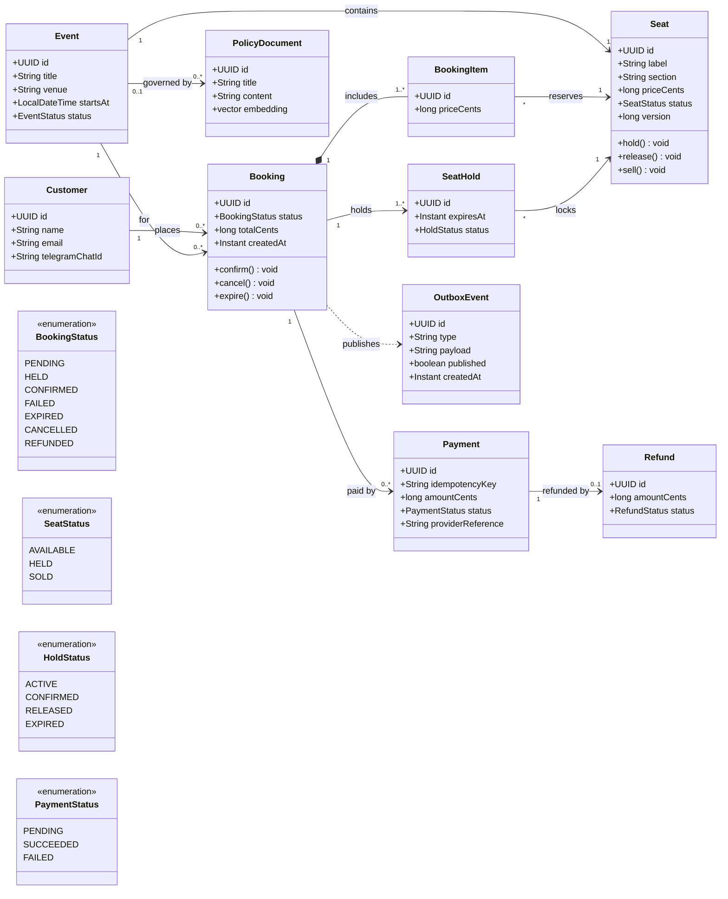

# UML: use cases and class diagram

Draft for review. Requirement references point to docs/requirements/SRS.md.

## Use case diagram

The AI agent can hold seats and request cancellation only through controlled tools. Cancellation requires explicit customer confirmation. The agent has no path to payment confirmation or refunds.

## Class diagram

## Invariants

- At most one ACTIVE hold exists per seat. The database enforces this with a conditional update and row locking. `version` supports optimistic locking.
- `Payment.idempotencyKey` is unique, so a repeated request cannot create a second charge.
- `OutboxEvent` is written in the same transaction as the booking change. This prevents "DB updated, event lost".
- `PolicyDocument` belongs to the AI and RAG side. Booking and inventory never read it.
